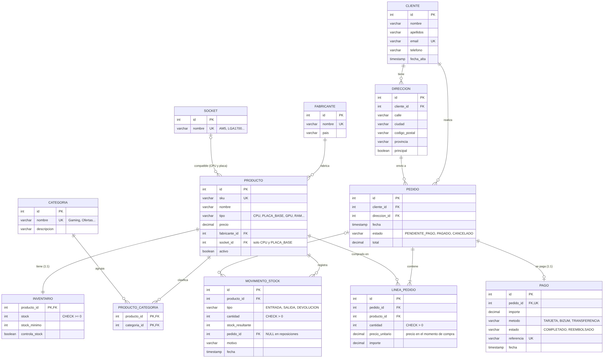
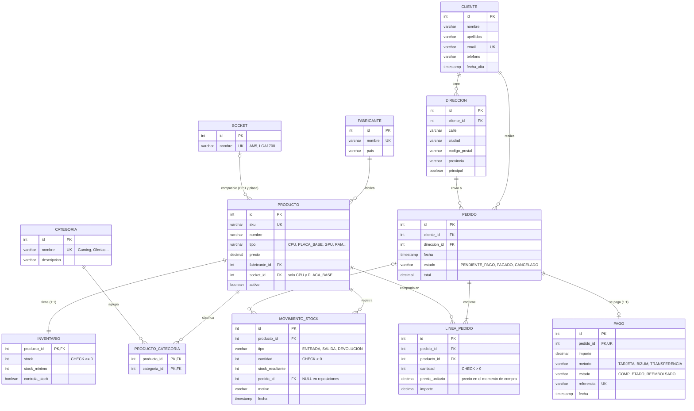

# Modelo entidad-relación · TiendaComponentes

## Relaciones

| Tipo | Entre | Cómo se resuelve |
|---|---|---|
| 1:N | `fabricante` → `producto` | FK `producto.fabricante_id` |
| 1:N | `socket` → `producto` | FK opcional `producto.socket_id` (solo CPU y placas base) |
| 1:N | `cliente` → `direccion`, `cliente` → `pedido` | FK `cliente_id` |
| 1:N | `pedido` → `linea_pedido` | FK `linea_pedido.pedido_id` |
| 1:N | `producto` → `movimiento_stock` | FK `movimiento_stock.producto_id` |
| **1:1** | `producto` ↔ `inventario` | La PK de `inventario` es a la vez FK a `producto` |
| **1:1** | `pedido` ↔ `pago` | FK `pago.pedido_id` con `UNIQUE` |
| **N:M** | `producto` ↔ `categoria` | Tabla intermedia `producto_categoria` con PK compuesta |
| N:M | `pedido` ↔ `producto` | Tabla intermedia con datos propios: `linea_pedido` |

## Decisiones de diseño

- **`tipo` frente a `categoria`.** El tipo técnico (CPU, placa base, GPU...) es único por producto y lo usan
  las reglas de negocio, por eso es una columna. Las categorías son agrupaciones comerciales
  (Gaming, Ofertas...) y un producto puede estar en varias: de ahí la relación N:M.
- **Compatibilidad por socket (rasgo propio de la tienda).** CPU y placa base guardan su socket.
  Permite la consulta "placas compatibles con una CPU" y la regla que rechaza un pedido que
  combine CPU y placa de sockets distintos. Una restricción `CHECK` garantiza que solo
  CPU y placas tengan socket.
- **Precio histórico.** `linea_pedido.precio_unitario` copia el precio en el momento de la compra:
  si el catálogo cambia después, el pedido conserva su importe.
- **Stock con trazabilidad.** `inventario.stock` es el valor actual y `movimiento_stock` explica cada
  cambio (ENTRADA por reposición, SALIDA por pedido, DEVOLUCION por cancelación). `CHECK (stock >= 0)`
  impide existencias negativas también a nivel de base de datos.
- **Importes con `DECIMAL(10,2)`** (en Java, `BigDecimal`) y fechas con `TIMESTAMP` (`LocalDateTime`).
- **Ciclo de vida del pago.** Se crea al pagar (COMPLETADO); si se cancela un pedido pagado pasa a
  REEMBOLSADO. El estado del pedido impide cancelar dos veces.

## Código del diagrama (Mermaid)

